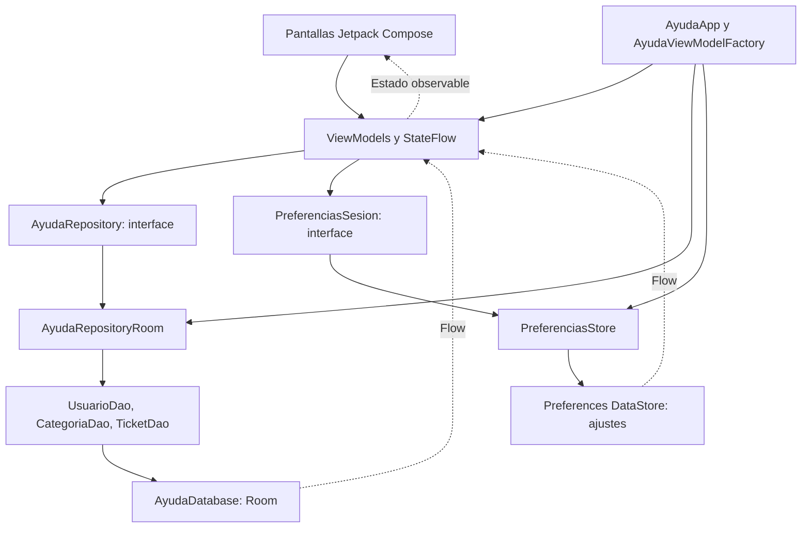
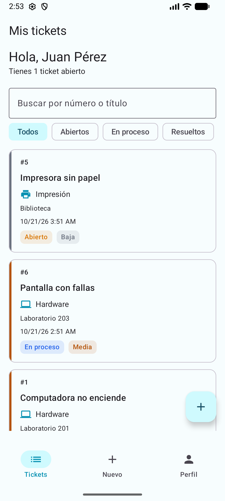
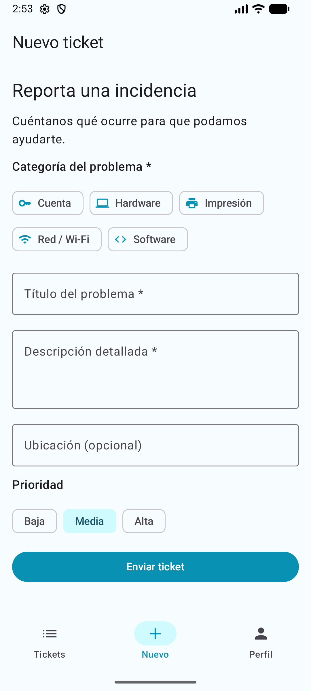
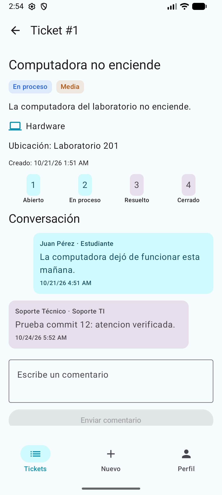
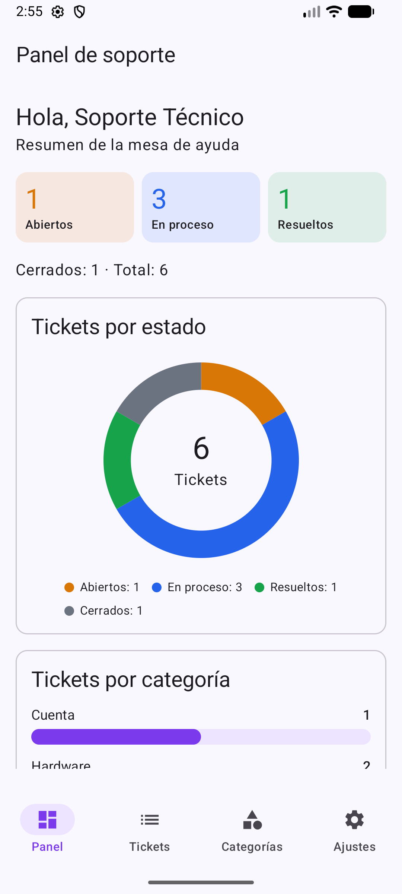
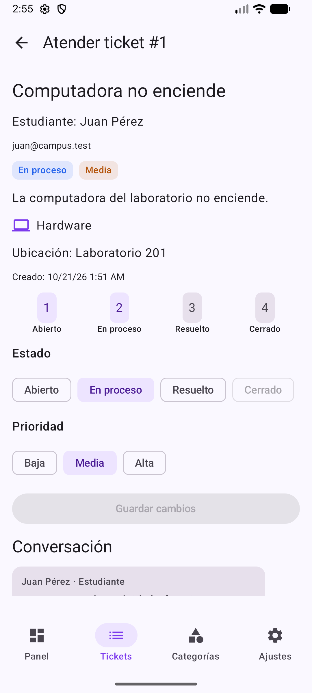
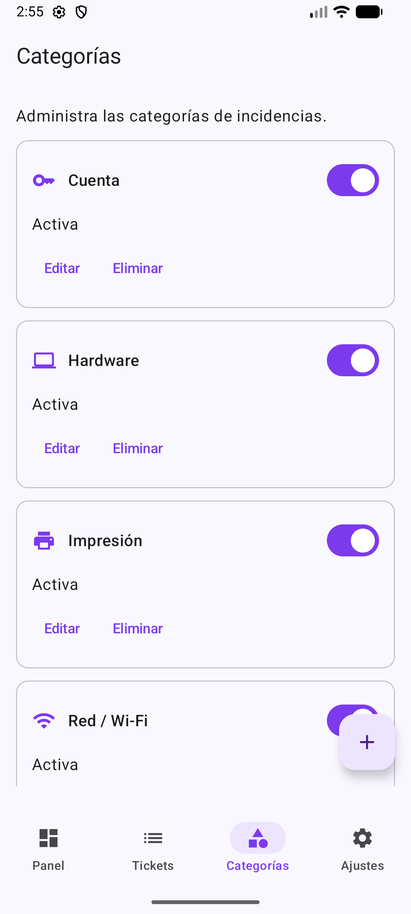

# AyudaCampus

Mesa de ayuda TI del campus desarrollada para el laboratorio de la semana 08 de Programación en Móviles. Permite que un estudiante registre incidencias, converse con Soporte TI y califique la atención; soporte consulta indicadores, atiende tickets y administra categorías.

El objetivo académico es aplicar **MVVM + Repository**, persistencia relacional con Room, preferencias con DataStore y una interfaz reactiva con Jetpack Compose. Es una aplicación de práctica **local**: ambas cuentas comparten la base de datos del mismo dispositivo; no existe un servidor ni sincronización entre dispositivos. Los datos de demostración son ficticios.

## Tecnologías

Versiones declaradas en `gradle/libs.versions.toml`, `app/build.gradle.kts` y el wrapper:

| Tecnología | Versión o configuración |
|---|---|
| Kotlin / plugin Compose | 2.2.10 declarada en el catálogo; Kotlin integrado en AGP |
| Android Gradle Plugin / Gradle Wrapper | 9.3.3 / 9.5.0 |
| Jetpack Compose y Material 3 | BOM 2026.02.01; las bibliotecas Compose no fijan versión individual |
| Activity Compose / Core KTX | 1.13.0 / 1.19.1 |
| Lifecycle Runtime KTX | 2.11.0 |
| Lifecycle ViewModel Compose / Runtime Compose | 2.8.6 declarada en ambas dependencias |
| Navigation Compose | 2.8.2 |
| Room Runtime, KTX y Compiler | 2.8.4 |
| KSP | 2.3.10 |
| DataStore Preferences | 1.1.1 |
| JUnit | 4.13.2 |
| Coroutines Test | 1.10.2 |
| Android SDK | mínimo 24; compilación y destino 37 |
| Compatibilidad de código Java | 11; no equivale al JDK requerido para ejecutar Gradle |

La aplicación usa Kotlin Coroutines, `Flow` y `StateFlow`. No declara una versión directa de Coroutines para producción: se obtiene mediante las dependencias transitivas. MVVM y Repository son patrones de arquitectura, no bibliotecas versionadas. La guía menciona Room 2.6.1; esta implementación utiliza la versión **2.8.4** configurada en Gradle.

## Requisitos y ejecución

1. Clonar `SebastianEspiritu/Programacion-Moviles-Espiritu-B` y abrir **`semana-08/AyudaCampus`** como proyecto en Android Studio.
2. Utilizar una versión de Android Studio compatible con AGP 9.3.3 y configurar su JDK de Gradle compatible. La compilación verificada utilizó el JBR 25 incluido en el entorno de Android Studio.
3. Instalar Android SDK Platform 37 desde SDK Manager y sincronizar Gradle. La primera sincronización necesita descargar las dependencias.
4. Seleccionar el módulo `app` y un emulador o dispositivo con Android API 24 o superior; ejecutar desde Android Studio.
5. En Login, seleccionar Estudiante o Soporte TI e introducir las credenciales de demostración definidas en `data/local/DatosIniciales.kt`. El rol seleccionado debe coincidir con el de la cuenta. No se publican contraseñas en este documento.

Desde la raíz de AyudaCampus, en PowerShell:

```powershell
.\gradlew.bat :app:assembleDebug
.\gradlew.bat :app:testDebugUnitTest
git diff --check
```

En macOS/Linux, usar `./gradlew` en lugar de `.\gradlew.bat`. El APK debug se genera en `app/build/outputs/apk/debug/app-debug.apk`; los reportes unitarios, en `app/build/reports/tests/testDebugUnitTest/index.html`.

El primer arranque carga datos de demostración mediante `DatosIniciales`. La sesión espera esa inicialización antes de autenticarse o restaurarse. Las instalaciones nuevas parten de esos datos; las capturas muestran una base de práctica ya utilizada. Para conservar datos existentes, no desinstalar ni borrar el almacenamiento de la aplicación. Las pruebas instrumentadas requieren una autorización y protección de datos independientes; no forman parte de los comandos anteriores.

### Bienvenida y acceso

Tras la carga inicial, un arranque sin sesión válida muestra la bienvenida de AyudaCampus. Una sesión válida conserva el acceso directo a su pantalla principal. Cerrar sesión o cambiar a un perfil que necesita autenticarse abre Login directamente.

**Limitación temporal:** tanto «Comenzar» como «Ya tengo una cuenta» abren Login; todavía no existe Registro. Los enlaces «Regístrate» y «¿Olvidaste tu contraseña?» muestran un aviso de función no disponible: no crean cuentas ni envían correos. El Login mantiene la validación de credenciales y roles, y el modo oscuro persistente.

## Funcionalidades del Estudiante

- **Mis tickets:** lista reactiva de los tickets propios, búsqueda por número o título y filtros Todos, Abiertos, En proceso y Resueltos; tarjetas con categoría, estado y prioridad.
- **Nuevo ticket:** categorías activas, título, descripción, ubicación opcional y prioridad inicial MEDIA. Se validan categoría, título de al menos 5 caracteres y descripción de al menos 10, después de `trim()`. Se bloquean registros si la recepción está desactivada y pulsaciones duplicadas durante el envío.
- **Detalle y conversación:** datos del ticket y comentarios en orden cronológico, diferenciando estudiante y soporte. Solo se permite consultar y actuar sobre tickets propios; no se admiten mensajes vacíos ni comentarios en tickets cerrados.
- **Cierre y calificación:** un ticket RESUELTO puede cerrarse con una calificación de 1 a 5 estrellas y un comentario final opcional. El cierre guarda fecha y calificación.
- **Reapertura:** un ticket RESUELTO puede volver a ABIERTO; se limpian calificación y fecha de cierre. No se ofrece reabrir un ticket CERRADO.
- **Perfil:** nombre, correo, rol y contadores de tickets abiertos, resueltos y totales; acceso a Ajustes, cambio de cuenta y cierre de sesión.
- **Ajustes:** modo oscuro global y preferencia de notificaciones persistentes.

## Funcionalidades de Soporte TI

- **Panel:** contadores de ABIERTO, EN_PROCESO, RESUELTO y CERRADO, total de tickets, gráfico de dona por estado y barras por categoría, con datos de Room.
- **Alertas:** tickets con prioridad ALTA, estado ABIERTO y fecha de creación estrictamente anterior a una hora. El límite temporal se recalcula cada segundo mientras el flujo está activo; no depende únicamente de nuevas escrituras en Room.
- **Bandeja:** consulta de tickets con búsqueda por número o título, filtros de estado y acceso al subconjunto de alertas; información del estudiante, categoría y prioridad. La consulta general ordena ALTA, MEDIA, BAJA y, dentro de cada prioridad, fecha descendente.
- **Atención:** detalle, conversación y respuesta de soporte; selección de ABIERTO, EN_PROCESO o RESUELTO y modificación de prioridad. Soporte no puede cerrar ni calificar tickets; un ticket CERRADO bloquea las escrituras de atención y los comentarios.
- **Categorías:** listado, creación, edición, selección de icono, activación y desactivación. Se rechazan nombres vacíos o duplicados y se impide eliminar una categoría asociada a tickets.
- **Ajustes:** modo oscuro, notificaciones y recepción de nuevos tickets; primera autenticación de la otra cuenta mediante Login, cambios posteriores directos entre cuentas recordadas y cierre de sesión.

Las pantallas muestran estados de carga, vacío y error según el flujo correspondiente, con reintento donde está implementado. Los cambios persistidos se reflejan mediante las consultas observables.

## Arquitectura MVVM + Repository



Los composables presentan el estado y delegan acciones al ViewModel. Los ViewModels validan formularios, acceso y reglas de interacción; `AyudaRepositoryRoom` encapsula las operaciones de persistencia y aplica también validaciones y transacciones. Los DAOs contienen SQL y relaciones Room. No existe una capa de casos de uso.

DataStore tiene su propio contrato, `PreferenciasSesion`, implementado por `PreferenciasStore`: no pasa por `AyudaRepository`. `AyudaApp` proporciona instancias compartidas de base, repositorio y preferencias, y coordina la siembra inicial. `AyudaViewModelFactory` construye los ViewModels con sus dependencias. La UI recoge los estados con `collectAsStateWithLifecycle`.

## Árbol de paquetes

Estructura de `app/src/main/java/com/espiritu/ayudacampus/`:

```text
com.espiritu.ayudacampus/
├── AyudaApp.kt
├── MainActivity.kt
├── data/
│   ├── local/
│   │   ├── AyudaDatabase.kt
│   │   ├── DatosIniciales.kt
│   │   ├── dao/
│   │   │   ├── CategoriaDao.kt
│   │   │   ├── TicketDao.kt
│   │   │   └── UsuarioDao.kt
│   │   ├── entity/
│   │   │   ├── Categoria.kt
│   │   │   ├── Comentario.kt
│   │   │   ├── Ticket.kt
│   │   │   └── Usuario.kt
│   │   └── relation/TicketConDetalle.kt
│   ├── prefs/PreferenciasStore.kt
│   └── repository/
│       ├── AyudaRepository.kt
│       ├── AyudaRepositoryRoom.kt
│       └── ErroresOperacion.kt
├── model/
│   ├── ConteoCategoria.kt
│   ├── DatoGrafico.kt
│   ├── EstadoTicket.kt
│   ├── IconosCategoria.kt
│   ├── Prioridad.kt
│   └── Rol.kt
├── ui/
│   ├── cliente/
│   │   ├── BienvenidaScreen.kt
│   │   ├── DetalleTicketScreen.kt
│   │   ├── IconoAcceso.kt
│   │   ├── LoginScreen.kt
│   │   ├── MisTicketsScreen.kt
│   │   ├── NuevoTicketScreen.kt
│   │   ├── PerfilScreen.kt
│   │   └── SplashScreen.kt
│   ├── components/
│   │   ├── AppTopBar.kt
│   │   ├── AyudaButton.kt
│   │   ├── AyudaTextField.kt
│   │   ├── BurbujaComentario.kt
│   │   ├── EstadoChip.kt
│   │   ├── Estrellas.kt
│   │   ├── IconoCategoria.kt
│   │   ├── PrioridadChip.kt
│   │   ├── StepperTicket.kt
│   │   ├── TicketCard.kt
│   │   └── graficos/
│   │       ├── GraficoBarras.kt
│   │       └── GraficoDona.kt
│   ├── navigation/
│   │   ├── InicioAyuda.kt
│   │   ├── NavAyuda.kt
│   │   └── Rutas.kt
│   ├── soporte/
│   │   ├── AjustesScreen.kt
│   │   ├── AtenderTicketScreen.kt
│   │   ├── BandejaScreen.kt
│   │   ├── CategoriasScreen.kt
│   │   ├── FormularioCategoriaScreen.kt
│   │   └── PanelSoporteScreen.kt
│   └── theme/
│       ├── Color.kt
│       ├── Theme.kt
│       └── Type.kt
└── viewmodel/
    ├── AlertaTickets.kt
    ├── AtenderViewModel.kt
    ├── AyudaViewModelFactory.kt
    ├── BandejaViewModel.kt
    ├── CategoriasViewModel.kt
    ├── DetalleTicketViewModel.kt
    ├── MisTicketsViewModel.kt
    ├── NuevoTicketViewModel.kt
    ├── PanelSoporteViewModel.kt
    ├── PerfilViewModel.kt
    └── SesionViewModel.kt
```

Las pruebas unitarias están en `app/src/test/`; las instrumentadas existentes, en `app/src/androidTest/`. Las evidencias están en `docs/capturas/`.

## Persistencia

### Room

`AyudaDatabase` utiliza `ayudacampus.db`, esquema versión 1, y un singleton con `@Volatile`, doble comprobación dentro de `synchronized` y `applicationContext`.

| Entidad / tabla | Datos principales y relaciones |
|---|---|
| `Usuario` / `usuarios` | Identificador, nombre, correo, clave de demostración y rol CLIENTE o ADMIN. |
| `Categoria` / `categorias` | Nombre, icono y estado activo. Una categoría puede agrupar muchos tickets. |
| `Ticket` / `tickets` | Cliente, categoría, título, descripción, ubicación, prioridad, estado, fecha, fecha de cierre y calificación opcionales. Claves foráneas a usuario y categoría. |
| `Comentario` / `comentarios` | Ticket, identificador/nombre/rol del autor, texto y fecha. Clave foránea a ticket con borrado en cascada. Los datos del autor se almacenan en el comentario; `autorId` no tiene una clave foránea a usuario. |

`TicketConDetalle` combina un ticket con su cliente, categoría y lista de comentarios mediante `@Embedded` y `@Relation`; las consultas del agregado usan `@Transaction`. Los ViewModels de detalle y atención ordenan los comentarios por fecha e identificador.

- `UsuarioDao`: autenticación local, búsqueda por identificador y siembra de usuarios.
- `CategoriaDao`: consultas de todas las categorías o solo activas y operaciones de mantenimiento.
- `TicketDao`: tickets, comentarios, estados, prioridades, cierre, reapertura y estadísticas. No existe un `ComentarioDao` separado.

Las lecturas reactivas devuelven `Flow`; las escrituras y consultas puntuales son `suspend`. El panel utiliza `COUNT` por estado y un `LEFT JOIN` de categorías con tickets, incluyendo categorías sin tickets. La integridad referencial y la comprobación previa del repositorio impiden eliminar categorías en uso.

### DataStore

`PreferenciasStore` utiliza una única instancia de Preferences DataStore llamada `ajustes`. Las escrituras con `edit` actualizan las preferencias y sus `Flow` propagan el cambio a los consumidores.

| Clave | Finalidad | Valor predeterminado |
|---|---|---|
| `perfilActivo` | Rol de la sesión guardada | Cadena vacía |
| `usuarioId` | Identificador para recuperar el usuario desde Room | 0 |
| `modoOscuro` | Tema global y apariencia de barras del sistema | `false` |
| `notificaciones` | Preferencia de notificaciones | `true` |
| `recibirTickets` | Disponibilidad local de la mesa de ayuda | `true` |

No se almacena la contraseña en DataStore. `SesionViewModel` recupera el usuario por ID y verifica su identidad y rol antes de restaurar la sesión. Solo los ID de cuentas autenticadas o restauradas válidamente se recuerdan en memoria durante la vida del ViewModel; esa lista no se persiste y no añade contraseñas ni tokens. Cerrar sesión elimina `perfilActivo` y `usuarioId` e invalida todas las cuentas recordadas, conservando los ajustes. La recepción de tickets se comparte en este dispositivo y solo soporte puede cambiarla desde la aplicación.

## Navegación y seguridad

- Splash coordina la inicialización y restauración de sesión; Login valida credenciales y correspondencia entre perfil elegido y rol real.
- Estudiante (`CLIENTE`, cian): Tickets, Nuevo y Perfil, con detalle y Ajustes.
- Soporte TI (`ADMIN`, violeta): Panel, Tickets, Categorías y Ajustes, con atención y formulario de categorías.
- `NavAyuda` restringe los destinos por rol; los ViewModels administrativos requieren ADMIN y el detalle del estudiante comprueba la propiedad del ticket antes de permitir acciones.
- El primer cambio al otro perfil exige autenticar su cuenta en Login. Si ambas cuentas están recordadas en memoria, los cambios posteriores son directos, sin repetir credenciales. Una sesión restaurada válidamente también acredita su cuenta en esta ejecución.
- Antes de cada cambio directo se recupera el usuario mediante `obtenerUsuarioPorId()` y se revalidan ID y rol. DataStore guarda la nueva sesión antes de publicar el usuario activo. Seleccionar un perfil nunca modifica el rol real de una cuenta.
- Cerrar sesión explícitamente invalida todas las cuentas recordadas. Después de reiniciar se restaura únicamente la sesión activa válida; la otra cuenta necesita su primera autenticación de nuevo.
- `NavController` y `NavHost` comparten `key(usuario?.id, usuario?.rol)`: al cambiar de sesión se descarta el grafo anterior y Atrás no recupera sus pantallas.

Estas restricciones corresponden a una práctica local, no a autorización de un servidor. Las claves de demostración se guardan en Room sin un mecanismo de autenticación de producción.

## Pruebas y verificaciones

**155 pruebas unitarias aprobadas, 0 fallos, 0 errores y 0 omitidas**, distribuidas en 13 clases de prueba. Incluyen siete pruebas de decisión de navegación inicial añadidas con el rediseño de bienvenida y Login. También se verificó `:app:assembleDebug`. La comparación visual de Bienvenida, Login Estudiante y Login Soporte TI en modo claro fue completada y aprobada por el usuario. Se verificaron campos vacíos con etiquetas persistentes, ausencia de recortes y conservación de Room y DataStore.

Las pruebas de `app/src/test/` cubren sesión y ajustes, filtros y búsquedas, validaciones de creación, detalle y comentarios, cierre/calificación y reapertura, panel y alertas temporales, bandeja, atención, categorías, restricciones por rol y pluralización. Incluyen cambio directo entre cuentas autenticadas, restauración válida, rechazo de sesiones inconsistentes, invalidación al cerrar sesión y fallos de persistencia. Se utilizan fakes del repositorio y herramientas de prueba de corrutinas; no equivalen a ejecutar Room real ni a probar la UI en un dispositivo.

Las comprobaciones **manuales en emulador** incluyeron navegación, carga de tickets y contadores, Perfil, persistencia de preferencias y sesión, cambio de cuenta, modo oscuro global, contraste de barras del sistema y pluralización. Las funciones de atención y categorías también se comprobaron manualmente durante el commit 12.

En el AVD independiente `AyudaCampus_Aceptacion_Fase1` se aprobaron **12/12 casos de aceptación** de las páginas 23–24 de la guía y la prueba adicional de recepción de tickets. La versión corregida del cambio de perfil se verificó visualmente partiendo de una sesión del estudiante restaurada: primera autenticación de soporte, cambios directos en ambos sentidos, identidades y navegación correctas e invalidación tras cerrar sesión explícitamente. La comparación final confirmó Room intacto: 2 usuarios, 6 categorías, 7 tickets y 5 comentarios. Este entorno de aceptación es independiente del utilizado para las seis capturas siguientes.

Existen pruebas instrumentadas en el proyecto, pero el resultado de 155 corresponde exclusivamente a pruebas unitarias JVM. No se ejecutaron pruebas instrumentadas para las últimas verificaciones ni para preparar estas evidencias.

Durante la captura de evidencias se confirmó integridad SQLite correcta, ausencia de errores de claves foráneas y conservación exacta de **2 usuarios, 5 categorías, 6 tickets y 5 comentarios**. Al terminar quedó la sesión del estudiante, modo oscuro desactivado, notificaciones y recepción activadas. Estas cifras describen ese estado de práctica, no son valores fijos de la aplicación.

## Evidencias

Seis capturas actuales del emulador, tres por perfil. Las capturas se obtuvieron mediante navegación, sin crear tickets, enviar comentarios ni modificar estados, prioridades o categorías.

### Estudiante

#### 1. Mis tickets: listado, búsqueda y filtros



#### 2. Nuevo ticket: formulario y prioridad inicial



#### 3. Detalle del ticket y conversación existente



### Soporte TI

#### 4. Panel: estadísticas y gráficos



#### 5. Atención: datos, estado y prioridad del ticket



#### 6. Administración de categorías



## Para pensar

**Borrador para revisión personal antes de entregar.** Preguntas de la sección 10 de la guía `GLAB-S08-JLEONS-2026_B.pdf` (página 26). Las cuatro respuestas ocupan cuatro líneas de fuente en total.

| Pregunta | Respuesta breve |
|---|---|
| ¿Por qué las reglas de estado están en el ViewModel y no en el DAO ni en el Composable? | El ViewModel decide las acciones según usuario y estado, independientemente de la UI; el DAO persiste y el Composable presenta, con validaciones adicionales en el repositorio. |
| ¿Por qué crearTicket es suspend y observarTicket es Flow? | Crear es una operación puntual que suspende sin bloquear; observar emite el detalle inicial y sus cambios para actualizar la pantalla. |
| ¿Qué pasaría si un ticket pudiera cerrarse sin calificación? | Se rompería el contrato de cierre de AyudaCampus y faltaría la valoración del estudiante; por eso se exige un valor de 1 a 5. |
| ¿Qué debería cambiar si mañana los tickets viven en un servidor? | Se implementaría AyudaRepository con una fuente remota y autenticación/autorización del servidor, conservando el contrato y adaptando errores y observación de cambios. |

## Limitaciones y alcance académico

- Los datos y cuentas viven en el dispositivo. No hay servidor, sincronización remota ni atención compartida entre teléfonos.
- Notificaciones es una preferencia persistida: no implementa envío de avisos, notificaciones push ni tareas de entrega en segundo plano.
- La autenticación local con cuentas de demostración requiere reemplazo para un entorno real; no deben utilizarse credenciales ni datos personales reales.
- El cambio directo requiere que ambas cuentas hayan sido autenticadas o restauradas válidamente y estén recordadas en memoria. El primer acceso a la otra cuenta sigue exigiendo credenciales, como protección del rol; esta condición limita el cambio incondicional propuesto por la guía.
- Este README documenta el estado funcional y las evidencias de la fase base. No acredita mejoras de la fase posterior en `mejora-ia` ni sustituye su `PROMPTS.md`.
- Se utilizó asistencia de IA durante el trabajo y la documentación; esta entrega no afirma un desarrollo sin IA. Las respuestas de reflexión deben revisarse y expresarse personalmente antes de entregar.
