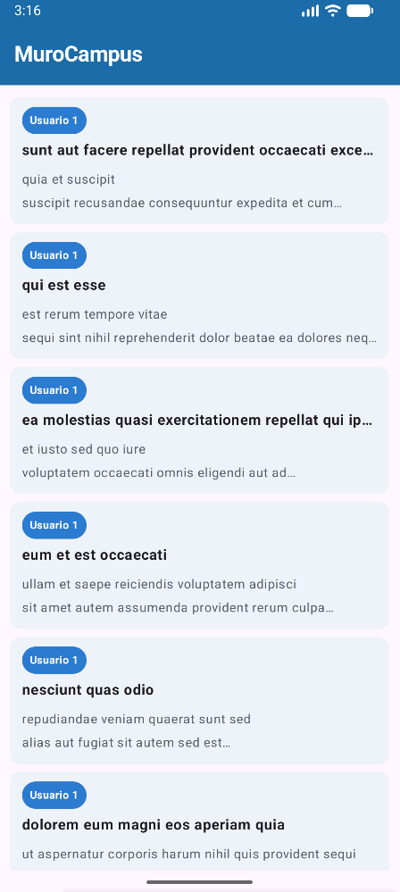
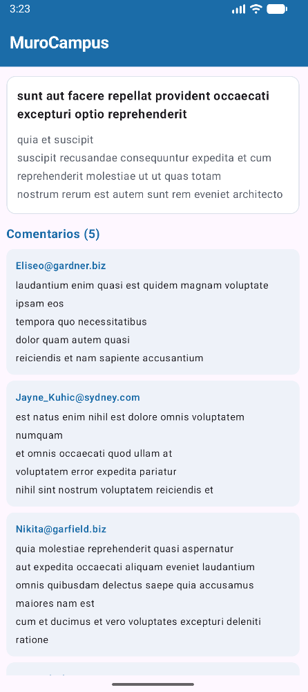
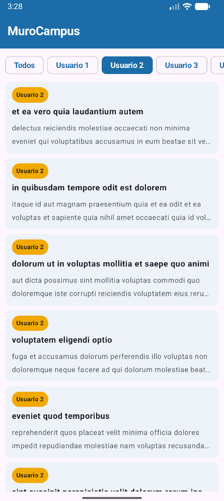
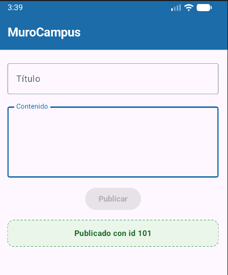
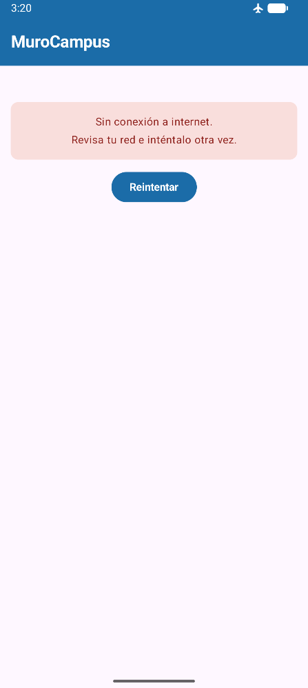

# MuroCampus

**Curso:** Programación en Móviles · Semana 09 · Servicios Web y plataforma REST

**Alumno:** Sebastian Espiritu

**Docente:** Juan León S.

## Descripción

MuroCampus es una app Android que consume el servicio web REST **JSONPlaceholder** (`https://jsonplaceholder.typicode.com/`):

- **Lista** las 100 publicaciones con la etiqueta del usuario, el título en negrita y las primeras líneas del texto.
- **Muestra el detalle** de una publicación con sus comentarios (`GET posts/{id}` y `GET posts/{id}/comments`, pedidos a la vez con `async`).
- **Filtra por usuario** con una fila de chips (`GET posts?userId=N`).
- **Crea una publicación** nueva con `POST posts` y muestra el id que devuelve el servidor (101).
- **Se comporta bien sin internet:** muestra el recuadro de error con el botón **Reintentar** en lugar de cerrarse.

Cada pantalla dibuja tres estados: **Cargando**, **Éxito** y **Error**. Los textos de las publicaciones están en latín de relleno (*lorem ipsum*) porque son datos de práctica del servicio.

**Tecnologías:** Kotlin, Jetpack Compose, Material 3, Retrofit 2.11, OkHttp 4.12 (con `HttpLoggingInterceptor`), kotlinx.serialization, corrutinas (`viewModelScope`, `async`, `coroutineScope`), `StateFlow` + `collectAsStateWithLifecycle`, MVVM + Repository con `Result`.

## Estructura de paquetes

```
com.espiritu.murocampus/
├── MainActivity.kt                 navegación lista / detalle / crear, FAB + y BackHandler
├── model/
│   └── Modelos.kt                  Post, Comentario, NuevoPost (+ Usuario)
├── data/
│   ├── remote/
│   │   ├── PostApi.kt              interface de Retrofit (@GET, @POST, @Path, @Query, @Body)
│   │   └── RetrofitClient.kt       object con OkHttp, logging y conversor JSON
│   └── PostRepository.kt           interface + PostRepositoryRemote (devuelve Result)
├── viewmodel/
│   ├── UiState.kt                  Cargando / Exito / Error y mensajeDe()
│   ├── PostsViewModel.kt           lista, detalle, filtro y crear
│   └── PostsViewModelFactory.kt
└── ui/
    ├── Componentes.kt              TarjetaPost, Cargando, ErrorConReintento
    ├── PantallaLista.kt
    ├── PantallaDetalle.kt
    ├── PantallaCrear.kt
    └── theme/
```

## Arquitectura MVVM + Repository

```
View (PantallaLista, PantallaDetalle, PantallaCrear)
   | eventos: cargar, filtrar, publicar      ^ collectAsStateWithLifecycle()
   v                                         |
ViewModel (PostsViewModel) --- StateFlow<UiState> (Cargando / Exito / Error) --->
   | viewModelScope.launch
   v
PostRepository (interface)        <- devuelve Result<...>
   -> PostRepositoryRemote           (captura IOException, HttpException...)
   |
   v
PostApi (Retrofit) --- OkHttp ---> https://jsonplaceholder.typicode.com/
```

| Capa | Conoce a | No debe |
|---|---|---|
| View (`ui/`) | Solo a su ViewModel | Llamar a Retrofit ni conocer `PostApi` |
| ViewModel | Solo a la interface `PostRepository` | Conocer Retrofit, `HttpException` ni `Context` |
| Repository | `PostApi` y las excepciones de red | Conocer la UI ni dejar escapar excepciones: devuelve `Result` |
| `data/remote` | Retrofit, OkHttp y el JSON | Guardar estado de pantalla |

## La API que usa la app

| Para… | Verbo y ruta | Función de `PostApi` |
|---|---|---|
| Listar publicaciones | `GET posts` | `listar()` |
| Ver una publicación | `GET posts/{id}` | `detalle(@Path("id") id)` |
| Ver sus comentarios | `GET posts/{id}/comments` | `comentarios(@Path("id") id)` |
| Filtrar por usuario | `GET posts?userId=2` | `porUsuario(@Query("userId") userId)` |
| Crear una publicación | `POST posts` con JSON en el cuerpo | `crear(@Body nuevo)` |

## Capturas

| Lista | Detalle y comentarios | Filtro por usuario |
|---|---|---|
|  |  |  |

| Crear publicación | Sin conexión |
|---|---|
|  |  |

## Pruebas de errores (Paso 10)

| Prueba | Cómo la provoqué | Resultado esperado | OK |
|---|---|---|---|
| Sin internet | Activé el modo avión y abrí la app | Sin conexión a internet y botón Reintentar | ✅ |
| Reintentar | Desactivé el modo avión y pulsé Reintentar | Carga la lista | ✅ |
| Recurso inexistente | Cambié el detalle para pedir `posts/9999` (temporal) | Error del servidor (404) | ✅ |
| JSON inesperado | Quité un campo de `Post` que sí llega (funciona por `ignoreUnknownKeys`) y luego agregué uno que no llega (temporal) | Funciona / Respuesta inesperada | ✅ |
| Cancelación | Abrí el detalle y volví rápido | No hay errores en Logcat | ✅ |
| Lista y detalle | Abrí varias publicaciones | Siempre 5 comentarios | ✅ |
| Filtro | Elegí cada usuario | Siempre 10 publicaciones | ✅ |
| Crear | Envié una publicación | Publicado con id 101 (en Logcat: `POST` y `<-- 201`) | ✅ |
| Código | Revisé `PostsViewModel.kt` | No hay Retrofit, `PostApi` ni `HttpException` | ✅ |

Los cambios temporales de las pruebas se deshicieron antes del commit.

## Para pensar

**1. ¿Qué diferencia hay entre GET y POST? ¿Por qué crear lleva `@Body` y porUsuario lleva `@Query`?**
`GET` **lee** un recurso sin cambiar nada en el servidor; `POST` **crea** un recurso nuevo. Para crear hay que enviar un objeto completo (`userId`, `title`, `body`), y eso va en el **cuerpo** de la petición como JSON: por eso `crear` usa `@Body`, y kotlinx.serialization convierte el `NuevoPost` en JSON. En cambio `porUsuario` solo lee una lista y necesita un filtro pequeño, que va en la **URL** como parámetro de consulta (`posts?userId=2`): por eso usa `@Query`. `@Path` es distinto: reemplaza una parte del camino (`posts/{id}` → `posts/1`) para identificar un recurso concreto.

**2. ¿Por qué la ruta es `"posts"` y no `"/posts"`?**
Porque Retrofit une la ruta con la `baseUrl`. Una ruta relativa (`"posts"`) se agrega al final de la base (`https://jsonplaceholder.typicode.com/` + `posts`). Una ruta que empieza con `/` es **absoluta**: reemplaza todo el camino de la `baseUrl` y deja solo el dominio. Con esta API funcionaría igual porque la base no tiene camino, pero si la base fuera `https://servidor.com/api/v1/`, `"/posts"` iría a `https://servidor.com/posts` y se perdería el `/api/v1/`. Por eso la `baseUrl` termina en `/` y las rutas no empiezan con `/`.

**3. ¿Por qué el Repository devuelve `Result` en vez de dejar que la excepción llegue al ViewModel?**
Porque una llamada de red **siempre puede fallar** (sin internet, error 404 o 500, JSON distinto), y con `Result` el fallo pasa a ser un valor normal que el ViewModel está obligado a manejar con `onSuccess` / `onFailure`. Así ninguna excepción se escapa y cierra la app, el ViewModel no necesita conocer `HttpException` ni Retrofit, y si mañana cambio la fuente de datos (por ejemplo Room) el ViewModel y la pantalla no cambian. La única excepción que se relanza es `CancellationException`, para no romper la cancelación de las corrutinas.

**4. ¿Qué pasa si olvidas el permiso INTERNET? ¿Y si olvidas `ignoreUnknownKeys` y el servidor agrega un campo nuevo?**
Sin el permiso `INTERNET` la app compila y abre, pero Android bloquea toda conexión: cada llamada falla con un error de red (por ejemplo `UnknownHostException`, que es una `IOException`) y la pantalla muestra **Sin conexión a internet** aunque el celular sí tenga internet. Sin `ignoreUnknownKeys = true`, kotlinx.serialization es estricto: si el JSON trae un campo que mi `data class` no tiene, lanza `SerializationException` y la app muestra **Respuesta inesperada**. Es decir, un cambio en el servidor (agregar un campo) rompería la app aunque los datos que uso sigan llegando.

**5. ¿Por qué la pantalla de lista usa un `when` sobre `UiState` y no un `if` con tres variables?**
Porque `UiState` es una `sealed interface`: la pantalla solo puede estar en **un** estado a la vez (Cargando, Exito o Error), y el `when` obliga a cubrir los tres casos (el compilador avisa si falta uno). Con tres variables sueltas (`cargando`, `lista`, `error`) se pueden dar combinaciones imposibles, como `cargando = true` con un error al mismo tiempo, y hay que acordarse de limpiar cada una. Además, los datos solo existen dentro de `Exito` y el mensaje solo dentro de `Error`, así que no hay valores nulos que revisar.

**6. JSONPlaceholder no guarda los POST. ¿Cómo cambiaría tu app si usaras un servicio real?**
Con un servicio real la publicación sí se guardaría y tendría un id distinto cada vez. Después de publicar habría que **actualizar la lista**: volver a llamar a `cargar()` o agregar el `Post` devuelto al inicio de la lista sin descargar todo de nuevo. También habría que manejar más casos: autenticación (un token en un encabezado, por ejemplo con un `Interceptor` de OkHttp), errores de validación del servidor (400/422) mostrando el mensaje, evitar envíos duplicados si el usuario pulsa dos veces, y usar el usuario que inició sesión en lugar de `userId = 1` fijo. Además, el `HttpLoggingInterceptor` en nivel `BODY` se quitaría en la versión de producción.
