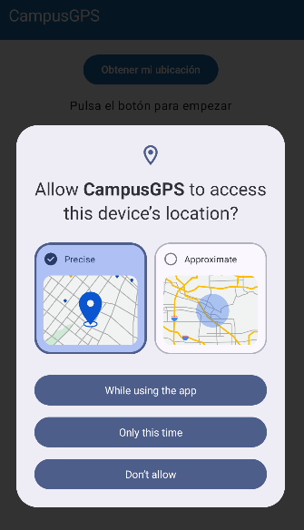
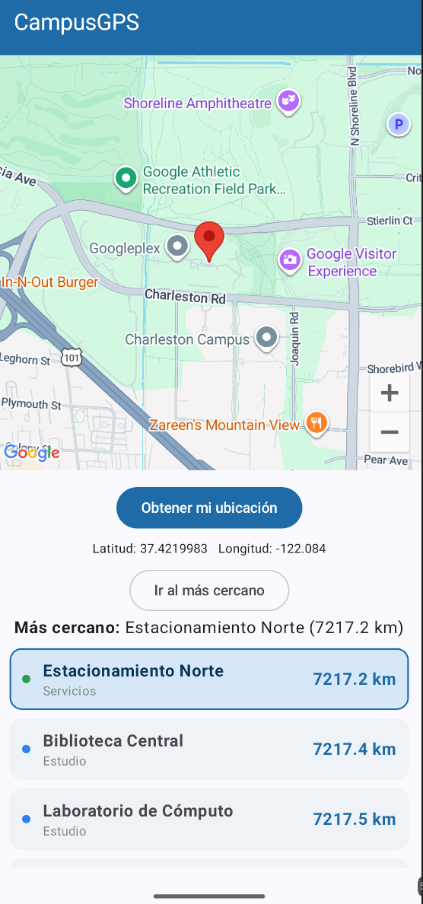
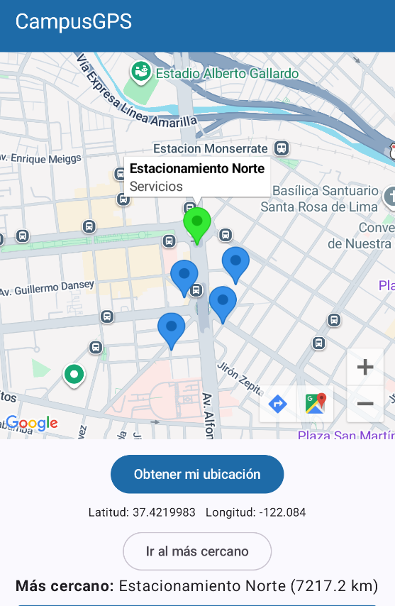
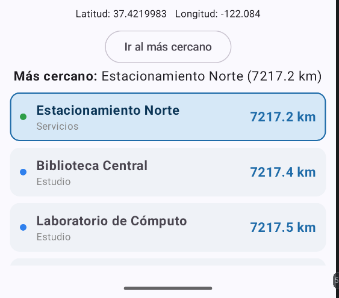
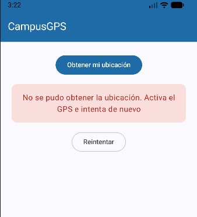

# CampusGPS

**Curso:** Programación en Móviles · Semana 13 · Localización Geográfica
**Alumno:** Sebastian Espiritu
**Docente:** Juan León S.

## Descripción

CampusGPS es una app Android que obtiene la ubicación del celular, la muestra en un mapa y te dice qué lugar del campus tienes más cerca. Muestra cinco puntos ficticios (biblioteca, cafetería, laboratorio, auditorio y estacionamiento) con su distancia en metros, ordenados del más cercano al más lejano. El más cercano se marca en verde y se puede ir hasta él con un botón.

La app sigue funcionando aunque el usuario niegue el permiso, apague el GPS o no tenga Google Play Services: en cada caso muestra un mensaje claro y una acción útil.

**Tecnologías:** Kotlin, Jetpack Compose, Material 3 (sin XML), Google Play Services Location (`FusedLocationProviderClient`), Maps Compose, MVVM + Repository.

## Estructura de paquetes

```
com.espiritu.campusgps/
├── MainActivity.kt
├── model/
│   └── Modelos.kt                  Posicion, Lugar, LugarConDistancia, UbicacionUi, TipoError
├── data/
│   ├── UbicacionRepository.kt      interface (+ playServicesDisponible)
│   ├── UbicacionRepositoryGoogle.kt implementación con FusedLocationProviderClient
│   ├── LugaresRepository.kt        interface
│   └── LugaresRepositoryLocal.kt   los 5 lugares ficticios
├── util/
│   ├── Distancia.kt                distanciaMetros() con Location.distanceBetween
│   └── Formato.kt                  formatearDistancia() en m o km
├── viewmodel/
│   ├── MapaViewModel.kt            estado, lugares, seleccionado y masCercano
│   └── CampusViewModelFactory.kt
└── ui/
    ├── PantallaMapa.kt             pantalla principal y permiso en tiempo de ejecución
    ├── MapaUbicacion.kt            GoogleMap, marcadores y cámara
    ├── ListaLugares.kt             tarjetas con la distancia
    ├── MensajeError.kt             mensaje y acción según el tipo de error
    └── theme/
```

## Arquitectura MVVM + Repository

```
View (PantallaMapa)
   | evento: pulsar el botón         ^ collectAsState()
   v                                 |
ViewModel (MapaViewModel) --- StateFlow --->
   | llama a las interfaces
   v
UbicacionRepository ---> UbicacionRepositoryGoogle (FusedLocationProviderClient)
LugaresRepository    ---> LugaresRepositoryLocal (los 5 lugares fijos)
```

| Capa | Conoce a | No hace |
|---|---|---|
| View (`ui/`) | Solo a su ViewModel | No usa Repository ni `FusedLocationProviderClient`, no calcula distancias |
| ViewModel | Solo a las interfaces de Repository | No conoce Composables ni recibe `Context` |
| Repository | Google Play Services (en la implementación) | No expone clases de UI |
| `util/` | Funciones puras | No guarda estado |

## Lugares del campus (datos ficticios)

| Id | Nombre | Categoría | Latitud | Longitud |
|---|---|---|---|---|
| 1 | Biblioteca Central | Estudio | -12.0460 | -77.0435 |
| 2 | Cafetería Campus | Comida | -12.0470 | -77.0420 |
| 3 | Laboratorio de Cómputo | Estudio | -12.0455 | -77.0415 |
| 4 | Auditorio Principal | Eventos | -12.0480 | -77.0440 |
| 5 | Estacionamiento Norte | Servicios | -12.0440 | -77.0430 |

## Cómo ejecutarlo

1. Crear una clave de API en Google Cloud con **Maps SDK for Android** habilitado y restringida al paquete `com.espiritu.campusgps` y a la huella SHA-1 (`./gradlew signingReport`).
2. Agregar la clave en `local.properties` (este archivo no se sube a GitHub):
   ```
   MAPS_API_KEY=tu_clave
   ```
3. Usar un emulador con Google Play y poner su ubicación en el punto base: Extended controls → Location → `-12.0464`, `-77.0428` → Set location.
4. Sincronizar Gradle y ejecutar.

## Capturas

| Permiso | Mapa con mi ubicación | Marcadores |
|---|---|---|
|  |  |  |

| Lista ordenada | Error |
|---|---|
|  |  |

## Pruebas de aceptación

- [ ] Abrir la app por primera vez y pulsar el botón → aparece el cuadro de permiso
- [ ] Aceptar el permiso → se ven latitud, longitud y el marcador "Estás aquí"
- [ ] Negar el permiso → mensaje de error con "Abrir ajustes", la app no se cierra
- [ ] Ubicación en el punto base → los 5 marcadores azules aparecen cerca de mi posición
- [ ] Tocar un marcador → se ve el nombre y la categoría del lugar
- [ ] Lista de lugares → ordenada de menor a mayor distancia, con m o km
- [ ] Tocar una tarjeta de la lista → la cámara viaja a ese lugar y la tarjeta queda resaltada
- [ ] Ir al más cercano → la cámara va al lugar verde; el botón está deshabilitado antes de buscar
- [ ] Cambiar la ubicación del emulador y buscar otra vez → se actualizan distancias, orden y lugar verde
- [ ] Ubicación apagada → mensaje de GPS con "Reintentar"
- [ ] Rotar la pantalla → no se pierden la ubicación ni la lista
- [ ] Revisar el repositorio → `git grep "tu_clave"` no encuentra nada y `local.properties` no está subido

## Para pensar

**1. ¿Por qué `FusedLocationProviderClient` está dentro del Repository y no en el ViewModel?**
Porque obtener la ubicación es un detalle de la fuente de datos, no de la lógica de la pantalla. El cliente necesita un `Context` y depende de Google Play Services; si estuviera en el ViewModel, este tendría que recibir un `Context` y quedaría atado a Google. Al dejarlo en `UbicacionRepositoryGoogle`, el ViewModel solo conoce la interface `UbicacionRepository`: se puede cambiar la implementación (por ejemplo, una falsa para pruebas) sin tocar el ViewModel ni la pantalla.

**2. ¿Qué diferencia hay entre el permiso de ubicación y la clave de API de Maps? ¿Qué pasa si falta cada uno?**
Son dos servicios distintos. El permiso de ubicación (`ACCESS_FINE_LOCATION` / `ACCESS_COARSE_LOCATION`) lo concede el **usuario** y permite leer dónde está el celular. La clave de API identifica a **mi app** ante Google para poder dibujar el mapa. Si falta el permiso, no se puede obtener la posición: la app muestra el mensaje "Sin permiso de ubicación..." con el botón "Abrir ajustes", pero el mapa se sigue viendo. Si falta la clave (o es incorrecta), el mapa sale gris o en blanco, aunque la ubicación, las distancias y la lista sí funcionan.

**3. ¿Por qué la clave va en `local.properties` y no en el código? ¿Qué harías si se subiera a GitHub por error?**
Porque `local.properties` está en el `.gitignore` y nunca se sube al repositorio. Gradle la lee y la pasa al Manifest con `manifestPlaceholders`, así la clave no aparece en ningún archivo de código. Si estuviera en el código, cualquiera que vea el repositorio podría copiarla y usarla a mi nombre. Si se subiera por error, la borraría en Google Cloud y crearía una clave nueva, porque la anterior ya no es segura (aunque se borre el archivo, queda en el historial de Git). Luego revisaría el `.gitignore`.

**4. ¿Dónde calculas la distancia y por qué no en el Composable?**
La función `distanciaMetros()` está en `util/Distancia.kt` y se llama solo desde `actualizarDistancias()` en el `MapaViewModel`, cuando llega la ubicación. El ViewModel calcula, ordena y publica la lista en un `StateFlow`; la pantalla solo dibuja lo que recibe. Si se calculara en el Composable, se repetiría en cada recomposición, la lógica quedaría mezclada con la vista y se rompería MVVM. Además, en el ViewModel el resultado sobrevive a la rotación de pantalla.

**5. ¿Qué pasa con tu app si el usuario niega el permiso dos veces? ¿Cómo lo manejas?**
Desde Android 11, si el usuario niega el permiso dos veces, Android deja de mostrar el cuadro de permiso: el lanzador devuelve "denegado" al instante sin preguntar. Mi app no se cierra: el resultado llega a `vm.permisoDenegado()`, que pone el estado `Error` de tipo `SIN_PERMISO`, y la pantalla muestra el mensaje con el botón **"Abrir ajustes"**. Ese botón abre los ajustes de la app con `Settings.ACTION_APPLICATION_DETAILS_SETTINGS`, donde el usuario puede activar el permiso manualmente y volver a pulsar "Obtener mi ubicación".
