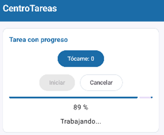
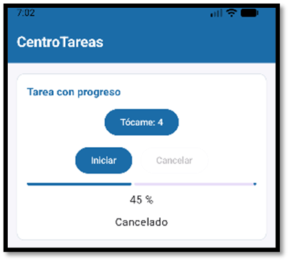
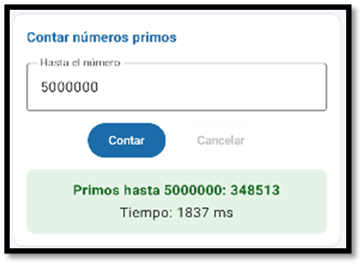
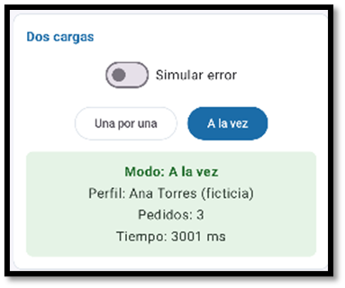
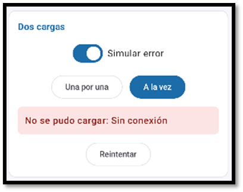

# CentroTareas

**Curso:** Programación en Móviles · Semana 14 · Hilos en Android
**Alumno:** Sebastian Espiritu
**Docente:** Juan León S.

## Descripción

CentroTareas es una app Android que hace tres cosas que tardan, sin congelar nunca la pantalla:

- **Tarea con progreso:** una tarea de unos 4 segundos con barra de progreso, que se puede cancelar a mitad de camino.
- **Contar números primos:** un cálculo pesado que usa mucho procesador, hecho en segundo plano y cancelable.
- **Dos cargas:** carga un perfil (2 s) y unos pedidos (3 s), una por una o a la vez con `async`, y muestra un error claro con botón **Reintentar** cuando la carga falla.

El botón **Tócame** es la prueba de vida: si deja de sumar, la pantalla está congelada. Primero se provoca el problema con `Thread.sleep` en el hilo principal y luego se resuelve con corrutinas. Todos los datos son ficticios.

**Tecnologías:** Kotlin, Jetpack Compose, Material 3 (sin XML), corrutinas (`viewModelScope`, `launch`, `withContext`, `async`, `Job`), `StateFlow`, MVVM + Repository.

## Estructura de paquetes

```
com.espiritu.centrotareas/
├── MainActivity.kt
├── model/
│   └── Estados.kt                  PrimosUi, CargaUi
├── data/
│   ├── TareasRepository.kt         interface
│   └── TareasRepositoryLocal.kt    cargas simuladas y contarPrimos (Dispatchers.Default)
├── viewmodel/
│   ├── TareasViewModel.kt          progreso, cancelar, primos, cargas y errores
│   └── TareasViewModelFactory.kt
└── ui/
    ├── PantallaTareas.kt           las tres tarjetas
    └── theme/
```

## Arquitectura MVVM + Repository

```
View (PantallaTareas)
   | eventos: botones              ^ collectAsState()
   v                               |
ViewModel (TareasViewModel) --- StateFlow --->
   | viewModelScope.launch { ... }
   v
TareasRepository (interface) ---> TareasRepositoryLocal
                                   (cargas simuladas y contar primos)
```

| Capa | Conoce a | No hace |
|---|---|---|
| View (`ui/`) | Solo a su ViewModel | No lanza corrutinas ni usa `Thread`; solo muestra el estado y avisa los eventos |
| ViewModel | Solo a la interface `TareasRepository` | No conoce Composables, no recibe `Context` y no bloquea el hilo principal |
| Repository | Nada de la UI | No expone estados de pantalla; sus funciones `suspend` no bloquean el hilo desde el que se llaman |

## Datos ficticios y valores de referencia

| Dato | Valor |
|---|---|
| Perfil simulado | Ana Torres (ficticia), tarda 2 s |
| Pedidos simulados | Pedido 101, 102 y 103, tardan 3 s |
| Una por una | 2 s + 3 s ≈ 5 s |
| A la vez (`async`) | máximo(2 s, 3 s) ≈ 3 s |
| Error simulado | Con el interruptor activado, los pedidos fallan con `IOException("Sin conexión")` |
| Número por defecto para primos | 5 000 000 → 348 513 primos en ≈ 2 s en mi emulador (con 500 000 tardaba menos de 1 s, por eso lo subí) |

## Observación del Paso 1

**¿Qué pasa con la pantalla?** Al pulsar **Tarea larga (MAL)** la app se congela durante 4 segundos: el botón **Tócame** deja de sumar, los botones no reaccionan al toque y nada se mueve. Cuando pasan los 4 segundos la app "despierta" de golpe, procesa los toques que quedaron en cola y el texto cambia directamente a **Terminó**.

**¿Por qué no se ve "Trabajando..."?** Porque `Thread.sleep(4000)` se ejecuta en el **hilo principal**, que es el mismo que dibuja la pantalla. El código sí cambia el mensaje a "Trabajando...", pero el hilo principal se queda dormido antes de poder dibujar ese cambio. Cuando despierta, el mensaje ya es "Terminó", así que solo se dibuja el valor final.

**¿Qué mostraría Android si la espera fuera de 10 segundos?** Mostraría el diálogo **ANR (Application Not Responding)**: *"CentroTareas no responde"*, con las opciones **Cerrar app** o **Esperar**. Android lo muestra cuando la app no responde a un toque en unos 5 segundos porque el hilo principal está bloqueado.

## Capturas

| Tarea con progreso | Cancelada | Contar primos |
|---|---|---|
|  |  |  |

| Una por una contra a la vez | Error y Reintentar |
|---|---|
|  |  |

## Pruebas de aceptación

| Prueba | Resultado esperado | OK |
|---|---|---|
| Tarea larga: tocar Tócame mientras trabaja | El contador sigue sumando | ✅ |
| Logcat con filtro `HILO` | `main` antes y después; `DefaultDispatcher-worker` dentro | ✅ |
| Iniciar la tarea con progreso | La barra avanza de 0 a 100 % en ≈ 4 s | ✅ |
| Cancelar a mitad | La barra se detiene, dice Cancelado y se puede iniciar otra vez | ✅ |
| Pulsar Iniciar dos veces seguidas | No se lanzan dos tareas (el botón está deshabilitado) | ✅ |
| Primos hasta 1000 | Resultado 168 | ✅ |
| Primos con N grande | La pantalla no se congela y Cancelar funciona | ✅ |
| Una por una | ≈ 5 s y resultado correcto | ✅ |
| A la vez | ≈ 3 s y resultado correcto | ✅ |
| Error simulado + Reintentar | Recuadro rojo; al desactivar el interruptor y reintentar, éxito | ✅ |
| Rotar la pantalla durante la tarea | La tarea continúa y el progreso no se reinicia | ✅ |
| Revisar el código | `git grep` no encuentra `GlobalScope`, `runBlocking` ni `Thread.sleep` en el código final | ✅ |

## Para pensar

**1. ¿Por qué no se veía "Trabajando..." en el Paso 1?**
Porque `Thread.sleep(4000)` bloqueaba el hilo principal, que es el único que dibuja la pantalla. El mensaje sí cambiaba a "Trabajando...", pero Compose no podía redibujar mientras el hilo dormía. Al despertar, el mensaje ya era "Terminó" y solo se dibujó ese valor.

**2. ¿Qué diferencia hay entre `Thread.sleep` y `delay`?**
`Thread.sleep` **bloquea** el hilo: durante la espera nadie más puede usarlo, y si es el hilo principal la pantalla se congela. `delay` **suspende** la corrutina: la corrutina se pausa, pero el hilo queda libre para dibujar y atender toques, y cuando termina la espera la corrutina continúa. Además, `delay` revisa la cancelación, por eso `Cancelar` detiene la barra al instante; `Thread.sleep` no se entera de la cancelación.

**3. ¿Por qué `Dispatchers.Default` para los primos y `Dispatchers.IO` para la red?**
Contar primos es trabajo de **CPU**: el procesador está ocupado todo el tiempo. `Dispatchers.Default` tiene tantos hilos como núcleos tiene el procesador, que es lo ideal para cálculos. La red o el disco, en cambio, pasan casi todo el tiempo **esperando** una respuesta sin usar el procesador. `Dispatchers.IO` tiene muchos más hilos (64 o más) para que esas esperas no ocupen los hilos de cálculo.

**4. ¿Qué pasaría con la corrutina si el usuario cierra la pantalla? ¿Qué papel cumple `viewModelScope`?**
`viewModelScope` está atado a la vida del ViewModel. Si el usuario cierra la pantalla definitivamente, el ViewModel se destruye (`onCleared()`) y `viewModelScope` **cancela automáticamente** todas sus corrutinas: no queda trabajo huérfano gastando batería ni intentando actualizar una pantalla que ya no existe. Si solo rota la pantalla, el ViewModel sobrevive, la corrutina sigue corriendo y el progreso no se reinicia.

**5. ¿Por qué `async` tarda 3 s y no 5 s? ¿Qué pasa si una de las dos cargas falla?**
Con `async` las dos cargas empiezan **al mismo tiempo**: el perfil termina a los 2 s y los pedidos a los 3 s, así que el total es lo que tarda la más lenta (≈ 3 s). Una por una, la segunda empieza cuando termina la primera (2 s + 3 s ≈ 5 s). Si una falla dentro de `coroutineScope`, se **cancela la otra** y la excepción sale del `coroutineScope` (concurrencia estructurada). Mi `catch` la atrapa y muestra el recuadro rojo "No se pudo cargar: Sin conexión" con el botón **Reintentar**, sin que la app se cierre.
