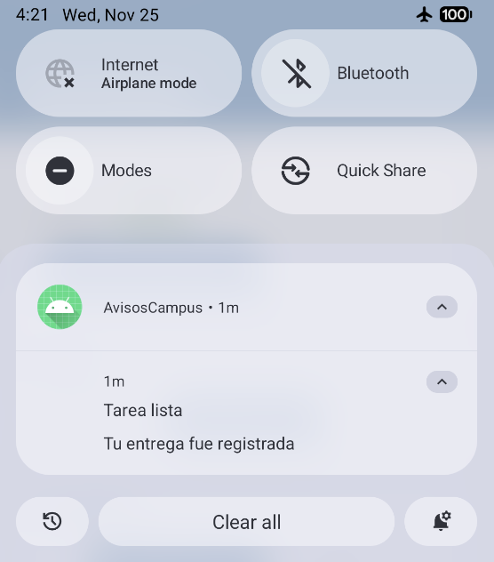
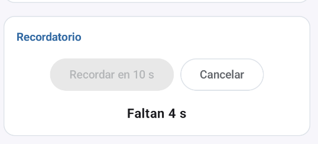
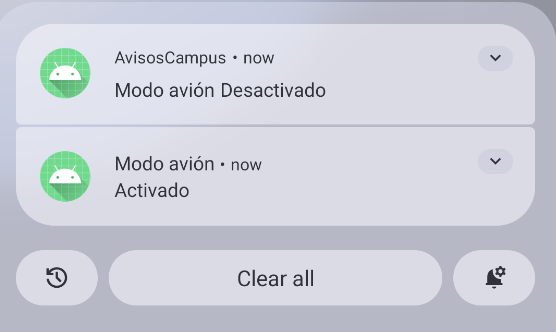
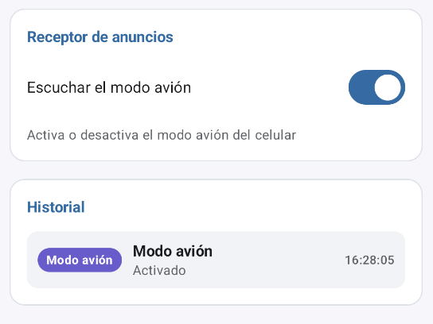
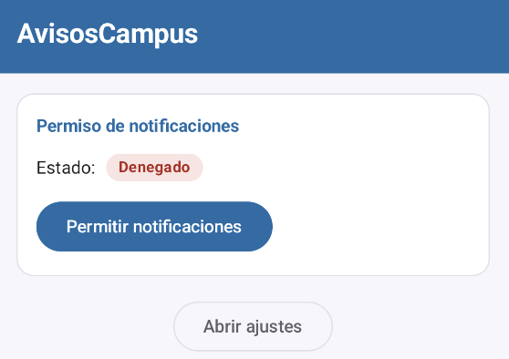
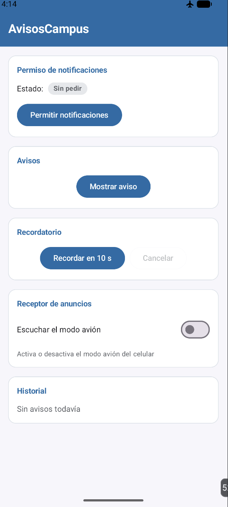
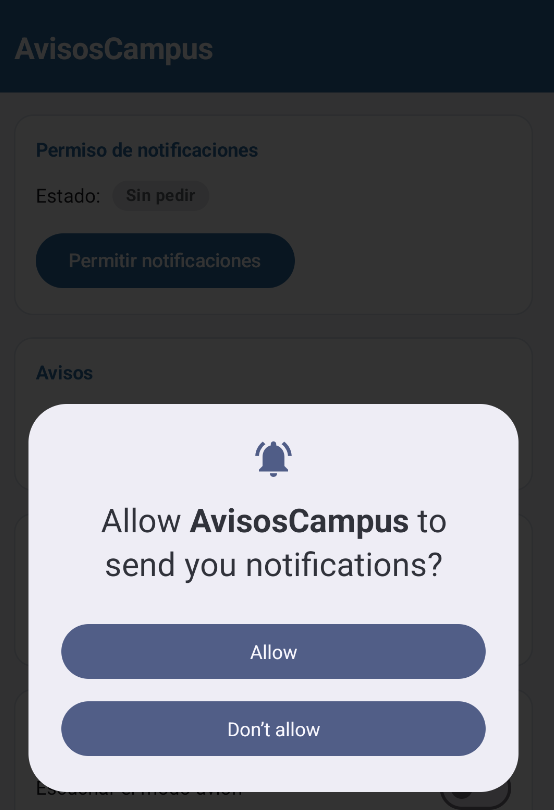
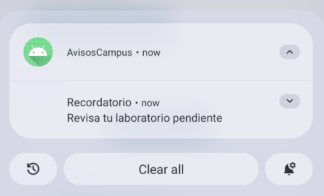

# AvisosCampus

**Curso:** Programación en Móviles · Semana 15 · Notificaciones en Android
**Alumno:** Sebastian Espiritu
**Docente:** Juan León S.

## Descripción

AvisosCampus es una app Android que muestra notificaciones y escucha lo que pasa en el celular:

- **Avisos:** el botón **Mostrar aviso** publica la notificación *Tarea lista*. Al tocarla se abre la app y la notificación desaparece.
- **Recordatorio:** **Recordar en 10 s** inicia una cuenta regresiva con corrutinas y, al llegar a 0, muestra la notificación *Recordatorio*. Se puede cancelar a mitad de camino.
- **Receptor de anuncios:** con el switch **Escuchar el modo avión** activado, un `BroadcastReceiver` avisa cuando se activa o desactiva el modo avión.
- **Historial:** todos los avisos quedan anotados, con lo más reciente arriba, su origen y su hora.
- **Permiso denegado:** si el usuario niega el permiso, la app no se cierra: guarda el aviso en el historial, muestra un mensaje y ofrece **Abrir ajustes**.

Todos los datos son ficticios.

**Tecnologías:** Kotlin, Jetpack Compose, Material 3 (sin XML), `NotificationChannel`, `NotificationCompat`, `PendingIntent`, permiso `POST_NOTIFICATIONS`, `BroadcastReceiver`, corrutinas (`viewModelScope`, `Job`, `delay`), `StateFlow` y `SharedFlow`, MVVM + Repository.

## Estructura de paquetes

```
com.espiritu.avisoscampus/
├── AvisosApp.kt                    Application: crea el canal
├── MainActivity.kt
├── model/
│   └── Modelos.kt                  Aviso, Origen, PermisoUi
├── data/
│   └── AvisosRepository.kt         interface + AvisosRepositoryMemoria
├── notificacion/
│   └── Notificador.kt              canal, permiso y mostrar
├── receiver/
│   └── ModoAvionReceiver.kt        escucha ACTION_AIRPLANE_MODE_CHANGED
├── viewmodel/
│   ├── AvisosViewModel.kt          permiso, avisos, recordatorio, receptor y errores
│   └── AvisosViewModelFactory.kt
└── ui/
    ├── PantallaAvisos.kt           las tarjetas
    ├── HistorialAvisos.kt          tarjeta Historial
    └── theme/
```

## Arquitectura MVVM + Repository

```
View (PantallaAvisos)
  | eventos: botones, switch          ^ collectAsState()
  v                                   |
ViewModel (AvisosViewModel) --- StateFlow (avisos, permiso, faltan, mensaje...) --->
  | registra el aviso                 | emite: eventos (SharedFlow<Aviso>)
  v                                   v
AvisosRepository (interface)        View recibe el evento y llama a
  -> AvisosRepositoryMemoria        Notificador.mostrar(context, aviso)
```

| Capa | Conoce a | No hace |
|---|---|---|
| View (`ui/`) | Solo a su ViewModel y al Notificador | No decide qué se avisa ni guarda el historial |
| ViewModel | Solo a la interface `AvisosRepository` | No conoce Composables, no recibe `Context` y no muestra notificaciones |
| Repository | Nada de la UI | No usa `Context` |
| Notificador | El sistema (canal, `NotificationManager`) | No guarda estado de la app |

## Datos ficticios

| Origen | Título | Texto |
|---|---|---|
| Botón | Tarea lista | Tu entrega fue registrada |
| Recordatorio (10 s) | Recordatorio | Revisa tu laboratorio pendiente |
| Modo avión | Modo avión | Activado / Desactivado |

## Capturas

| Notificación en el panel | Recordatorio | Modo avión |
|---|---|---|
|  |  |  |

| Historial | Permiso denegado |
|---|---|
|  |  |

**Capturas adicionales**

| Pantalla inicial | Cuadro de permiso (Android) | Notificación del recordatorio |
|---|---|---|
|  |  |  |

## Pruebas de aceptación (emulador Android 13 o superior)

| Prueba | Resultado esperado | OK |
|---|---|---|
| Abrir Ajustes → Apps → AvisosCampus → Notificaciones | Existe el canal Avisos | ✅ |
| Pulsar Permitir notificaciones | Aparece el cuadro de Android y la etiqueta cambia | ✅ |
| Pulsar Mostrar aviso | Aparece la notificación Tarea lista | ✅ |
| Pulsar Mostrar aviso dos veces | Aparecen dos notificaciones distintas | ✅ |
| Tocar la notificación | Se abre la app y la notificación desaparece | ✅ |
| Recordar en 10 s | Cuenta regresiva y aviso al llegar a 0 | ✅ |
| Recordar y minimizar la app | El aviso llega igual | ✅ |
| Recordar y cancelar | No llega ningún aviso | ✅ |
| Switch activado y cambiar el modo avión | Aviso Activado y luego Desactivado | ✅ |
| Switch desactivado y cambiar el modo avión | No hay aviso | ✅ |
| Permiso denegado y Mostrar aviso | Mensaje de error, aviso en el historial y la app no se cierra | ✅ |
| Rotar la pantalla durante el recordatorio | La cuenta regresiva continúa | ✅ |
| Revisar el código | No hay `Context` en `viewmodel/` y todo receptor registrado se quita en `onDispose` | ✅ |

## Para pensar

**1. ¿Por qué una notificación necesita un canal y un permiso? ¿Qué pasa si falta cada uno?**
Desde Android 8 (API 26) toda notificación pertenece a un canal, y es el canal el que define su importancia, sonido y vibración; además el usuario puede apagar cada canal por separado desde Ajustes. Si el canal no existe, la notificación simplemente no se muestra (Android la descarta y deja un aviso en Logcat). Desde Android 13 (API 33) también hace falta el permiso `POST_NOTIFICATIONS`, concedido por el usuario en tiempo de ejecución, para que ninguna app pueda llenar el panel sin su consentimiento. Si falta el permiso, `notify` no muestra nada; por eso `Notificador.mostrar` lo revisa antes y devuelve `false`.

**2. ¿Por qué el ViewModel emite un evento y no muestra la notificación él mismo?**
Porque para mostrar una notificación se necesita un `Context`, y el ViewModel vive más que la Activity (sobrevive a la rotación): si guardara un `Context` provocaría fugas de memoria. Además, así el ViewModel solo decide *qué* avisar y lo anota en el Repository, sin depender de Android, por lo que se puede probar con pruebas unitarias. La pantalla, que sí tiene `Context`, recibe el evento del `SharedFlow` y llama al `Notificador`.

**3. ¿Qué pasa si usas el mismo id en dos notificaciones?**
La segunda reemplaza a la primera: en el panel solo queda una notificación, con el contenido más reciente. Por eso se usa `aviso.id`, que es distinto para cada aviso; así al pulsar dos veces **Mostrar aviso** aparecen dos notificaciones. Reutilizar el id a propósito sirve para *actualizar* una notificación (por ejemplo, una barra de progreso).

**4. ¿Por qué `onReceive` debe ser corto y por qué hay que quitar el receptor al salir?**
`onReceive` se ejecuta en el hilo principal: si hace trabajo largo congela la pantalla y Android puede mostrar un ANR. Por eso solo lee el dato del `Intent` y se lo pasa al ViewModel. El receptor hay que quitarlo con `unregisterReceiver` en `onDispose` porque mantiene una referencia a la pantalla y al ViewModel: si se queda registrado se filtra memoria y seguiría recibiendo anuncios cuando ya nadie los necesita (o se registraría dos veces al rotar).

**5. ¿En qué casos usarías una notificación local y en cuáles una push de Firebase?**
Una **local** la crea la propia app en el celular, sin internet: recordatorios, alarmas, el fin de una descarga o algo que detecta el dispositivo (como el modo avión). Una **push de Firebase (FCM)** la envía un servidor y llega aunque la app esté cerrada: un mensaje nuevo en un chat, una nota publicada por el docente, una oferta o cualquier evento que ocurre fuera del celular.
